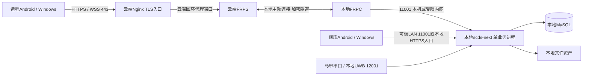
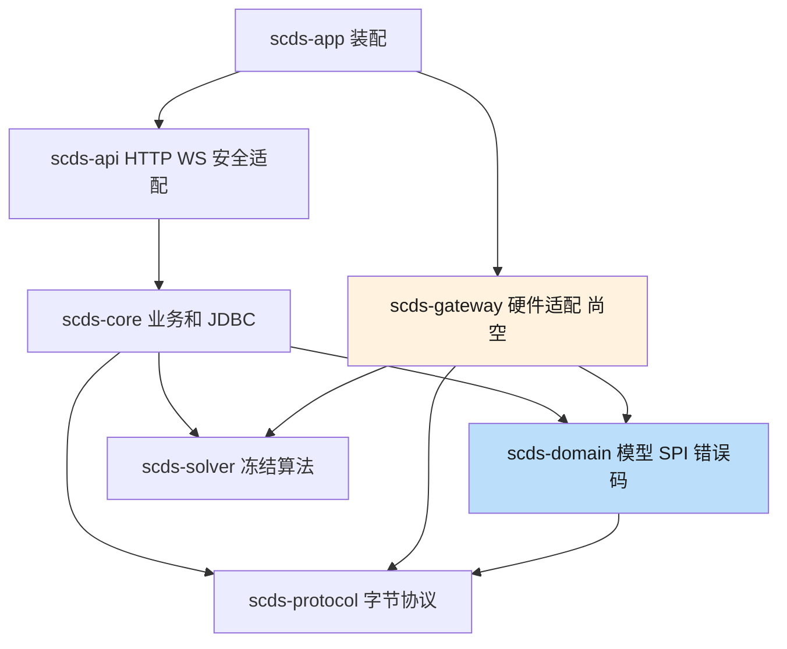
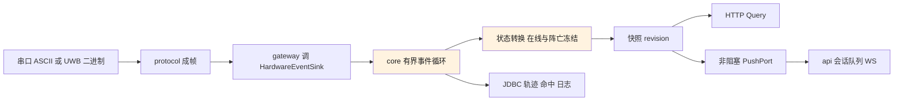

# scds-next 架构与实施方案

> 核查日期：2026-10-21。已实现和目标架构分开记录；源代码基线 `da02622`。
> 需求见 [requirements.md](requirements.md)，风险见 [review.md](review.md)。
> 2026-10-21最新部署决定：全部业务本地部署，云端仅Nginx/FRPS公网入口，
> 本地FRPC主动建立隧道。本文部署与鉴权边界取代旧云管、云签和双签发候选设计。
> 旧基线计数是历史记录，不代表本次架构变更已完成生产验收。

## 0. 本地部署拓扑（已确认）

- 开发机验证后迁入Mini PC/现场主机；每客户独立实例、数据库、密钥、文件和代理资源。
- 云端不部署scds-next、数据库、文件业务、账号管理或JWT签发；云端TLS证书不是业务JWT密钥。
- 账号access/refresh和deviceToken都由同一个本地业务实例签发，本地PEM验签。
  issuer、三种aud、设备sid、TTL、token_hash刷新及全端logout规则保持不变。
- auth/me读本地账号库，与登录共享身份源；不增加云端账号同步、JWT身份快照或第二个认证baseUrl。
- FRPC只是可选公网接入适配，不参与业务状态、账号授权或硬件事件；断隧道不停止本地服务。
- 外网中断时LAN客户端仍能本地登录、刷新和开展已实现业务；远程客户端不可达，
  不能把“本地可用”宣传成“远程断网可用”，也不自动保证未实现业务闭环。
- 本地HTTP固定11001、硬件UWB固定12001。云端443及隧道端口不改变契约业务端口。
- 只穿透HTTP/WS业务入口，不穿透MySQL、串口或未认证UWB TCP，不公开运维指标。

FRPC/Nginx样例与资源隔离要求见[部署说明](../deploy/README.md)。
域名、证书、FRPS监听/代理端口及凭据由部署阶段另行分配，不复用ZAA的站点或秘密。

## 1. 技术与依赖基线

| 项 | 实际基线 |
|---|---|
| Java / Maven | release 21；本机 Zulu 21.0.12.1、Maven 3.9.9 |
| Spring Boot | 根 pom parent 3.5.7；不是历史记忆中的 3.3.5 |
| Web / Security | 默认 Tomcat；resource-server 与 Nimbus，由 Boot BOM 管理 |
| 数据 | JdbcClient + NamedParameterJdbcTemplate 批量；Flyway；MySQL 本机 8.4.11 |
| 硬件依赖 | gateway pom 声明 jSerialComm 2.11.0、Netty；尚无适配源码 |
| 唯一可运行入口 | `com.dualx.ScdsNextApplication`，产物 `scds-app/target/scds-next.jar` |
| 前端目标 | Flutter Android/Windows；未创建工程，不指定尚未选定的状态管理库 |

## 2. 模块边界

下图箭头为编译依赖，“目标端口实现”不表示当前已有实现。

| 模块 | 当前主源码数 | 当前事实 |
|---|---:|---|
| protocol | 13 | Framer、下行编码、协议枚举；19项测试 |
| solver | 3 | Solver/Filter/参数；无测试，与原算法仅 package/import 差异 |
| domain | 40 | 领域 records、SPI、错误码；无 Spring/JDBC |
| gateway | 0 | 空 jar，不能实际采集或下发硬件事件 |
| core | 33 | 19 个仓储、认证基础组件和 AuthService；无演习/态势业务服务 |
| api | 79 | 手写 DTO、7个控制器、错误出口、安全与WS骨架；控制器业务仍占位 |
| app | 1 | 装配、调度开启、配置与 Actuator；无自动化启动测试 |

允许 api 依赖 core，禁止 core 依赖 api、gateway，禁止 gateway 依赖 core。
共享业务载体进入 domain；HTTP-only DTO 留 api。不能把“拆模块”当成业务已实现。

## 3. Ports & Adapters

| 方向 | domain 端口 | 调用者 | 目标实现者 | 当前 |
|---|---|---|---|---|
| 下行硬件 | DeviceLinkAdmin | core/api服务编排 | gateway | 只有接口 |
| 上行帧 | HardwareEventSink | gateway | core | 只有接口 |
| 签发令牌 | TokenSigner + 三种 claims | core | api.RsaTokenSigner | 已实现 |
| 态势推送 | SituationPushPort | core状态所有者 | api广播器 | 未创建 |
| 链路推送 | LinkStatusPushPort | gateway链路所有者 | api广播器 | 未创建，根类型待确认 |

gateway 负责字节流分片、成帧、合法性检查及链路事实，不直接更新业务表。
HardwareEventSink 不得在串口/Netty读线程做 JDBC、解算长计算或WS阻塞写。
核心接收端需有界队列、事件循环及溢出策略，先定义掉帧与优先级规则再实现。

DeviceLinkAdmin 目前“已打开先关闭重开”的注释与契约 409 ALREADY_OPEN 不一致，
而契约允许 UWB SERIAL、端口却只有 openUwbTcpServer。网关开工前先统一意图。
同一个物理串口只能由一个链路持有；协议上行/下行方向不同，不得复用编码格式。

## 4. 业务状态与存续

### 4.1 数据模型

迁移共有8份：V1-V7、V9。业务 UUID 主键由 UUIDv7 生成；马甲用协议自然编号，
轨迹/命中等流水自增。核心数据表为：

| 域 | 表 |
|---|---|
| 鉴权 | t_account、t_account_role、t_audit_log、t_refresh_token |
| 地图 | t_map、t_map_floor、t_anchor |
| 想定 | t_plan、t_plan_roster |
| 演习 | t_exercise、t_exercise_unit、t_exercise_log、t_exercise_command、t_hit_event |
| 轨迹导出 | t_track_sample、t_export_task |
| 设备 | t_vest、t_link_config |

`ended_at IS NULL` 的生成列唯一索引在库层保证仅一场进行中。
同一行演习结束后即为复盘，不复制第二份 replay 主键。t_ms 相对 started_at，
INT 类型不变。库中枚举按稳定名称存储，CHECK 约束与Java/契约一致。
当前schema没有外键，引用完整性与禁止删除在业务事务层实现，不能直接把仓储物理删除接控制器。

当前轨迹插入已用批量 JDBC，但测试连接默认未启用 rewriteBatchedStatements；
功能正确不等于批量性能达标。文件的对象/路径与生命周期尚未形成生产方案。

### 4.2 目标事件链

图中协议之后的硬件业务链目前未实现。
状态由core单一所有者持有，不能让Controller、gateway和WS各维护一份战场。
DB写失败时的状态一致性、轨迹丢失告警、命令超时与重试需明确验收条件。

## 5. 鉴权的已实现路径

AuthService login：先限流，再独立事务查账号并锁账号行，校验enabled和BCrypt，
更新lastLoginAt、签发并存refresh hash，事务提交后返回令牌与身份快照。
返回快照保留登录前的 lastLoginAt；me/refresh读库中当前身份。

refresh：hash定位、账号行锁、token锁定读，避免MySQL REPEATABLE READ的旧快照，
撤旧、置replaced_by、存新令牌原子提交。重放撤全部并先提交、后抛异常；
不会因外层事务回滚复原。logout同账号锁撤全部，防并发刷新在退出后遗留有效refresh。
17项MySQL IT覆盖此路径，尚未经HTTP公开。

API层通过SecurityConfig的aud授权、RsaTokenSigner与本地decoder适配JWT。
重要缺口：expired映射、必需claims、指标子路由、Boot MVC错误优先级、只验签路由行为。
AccountSession包含库Account（内有passwordHash），接线时只能显式映射User安全字段，
不能把这个核心内部载体直接JSON返回。旧[鉴权设计](design/03-auth.md)中的云端签发
及双用途issuer拆分不再适用；当前部署模型以本文第0节及环境手册为准，
复用本地AuthService和TokenSigner。

## 6. 演习自愈方案

原则已确认：重启不热接管；进行中场次全部冻结收尾，残留指令先SYSTEM存证再清理。
heartbeat、owner_instance、end_reason、非协议SYSTEM枚举、恢复门禁与单实例保护未实现。
原预留V8在V9已应用后不可盲补，建议确认V10递增迁移；不改历史SQL、不默认out-of-order。
Runner结束先于ApplicationReadyEvent，但不阻止端口提前收请求；必须有业务门禁。
具体见 [设计01](design/01-exercise-liveness.md)。

## 7. 推送与恢复候选方案

“谁持有状态谁调PushPort”已确认。推送载体拟下沉domain，Poll/WS复用同一类型和源。
态势revision单写事件循环，环形窗口；每会话有界队列和独立发送线程，不阻塞上游。
注册、首帧与增量须原子衔接；PING/PONG与业务帧也应走同一个发送队列。
丢帧后发送全量时要跳过旧队列数据，不能再发比该全量旧的增量。

尚待确认：链路数组/对象同构、跨进程epoch、WS超窗的409/close语义、
虚拟线程选型及队列容量。1024帧窗口按变化速率换算覆盖时间，不按2s Poll计算。
“每会话线程”也不自动证明慢客户端隔离，需要实际阻塞写与JDK21线程行为测试。
具体见 [设计02](design/02-push-ports.md)。

## 8. 配置与部署边界

`SCDS_PROFILE`决定Spring配置环境；本地业务部署显式启用`SCDS_JWT_SIGNING=true`。
`SCDS_DEPLOYMENT_MODE`是无消费者的历史兼容登记，保留PRIVATE默认值，
不再代表需要实现CLOUD业务节点，也不控制是否启用FRPC。
签发开关仍保持显式配置；false仅用于受控只验签测试/工具，不是现场完整业务部署。
远端JWKS不再属于目标能力，非空配置必须在本地绑定阶段失败，防止验签意外依赖外网。
业务JWT私钥、账号、绑定、数据库和文件只保存在本地；云端只保管TLS及FRPS入口配置。
FRPC原生运行时转发本机回环11001；如需要LAN直连，应用绑定经批准的LAN地址或网卡，
防火墙仅允许现场网段。容器FRPC的127.0.0.1不等于宿主机，不能盲抄ZAA容器localIP。
当前 deployment-mode 无消费者、硬件能力开关未实现、UWB参数尚无Spring绑定bean。
本仓库只有开发MySQL compose；deploy目录提供FRPC/Nginx配置样例，
不是已部署服务，尚无应用Dockerfile、生产Compose或服务管理安装脚本。
HTTP graceful 不管理串口、WS与TCP资源；完整生命周期需显式实现。

## 9. 分阶段实施与完成定义

| 顺序 | 工作包 | 完成门禁 |
|---|---|---|
| S0 | 审查安全/错误真实缺口 | 生产过滤链集成测试，明确401/403/400及claims |
| S1 | 设备签发能力决定、DeviceAuthService/SID | 登录顶替、事务失败及缓存主动失效回归 |
| S2 | 账号/设备控制器接线 | 5个auth占位移除，device/me按当前决定保留；false路由、DTO泄露、HTTP限流回归 |
| S3 | 迁移版本确认、自愈与SYSTEM日志 | V9已有库升级和空库路径、崩溃恢复与存证事务 |
| S4 | hardware适配与核心状态循环 | 串口/TCP硬件或仿真接入、在线边界、冻结、命令回执 |
| S5 | PushPort、载体、Query、WS | 两通道同构、补齐/超窗/跨代/背压/保活/停机 |
| S6 | 地图/想定/复盘/导出业务完善 | 事务、引用完整性、文件安全、统计与时间轴回归 |
| S7 | Flutter Android/Windows | 模拟器/真机/Windows连真实服务，Poll持续运行 |
| S8 | 生产与现场发布验证 | TLS、密钥、容量、离线、备份恢复、硬件、运维门禁 |

每个工作包再拆 <=3 文件原子任务；先给影响范围再写业务代码。
不得将当前文档任务自动扩为S0-S8实现或未经确认的架构改造。
